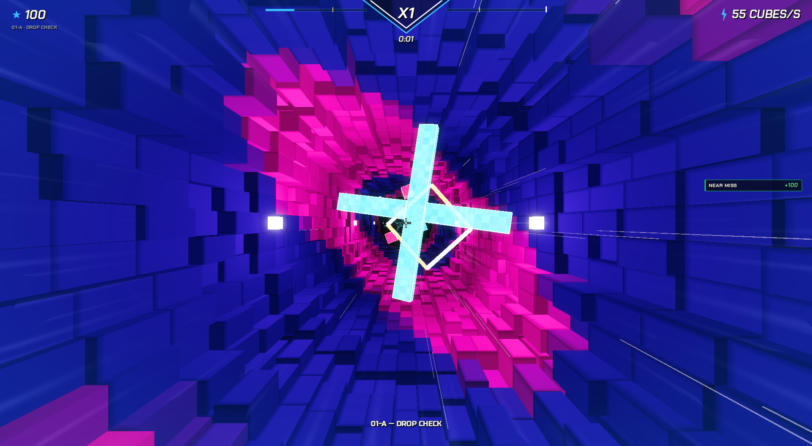
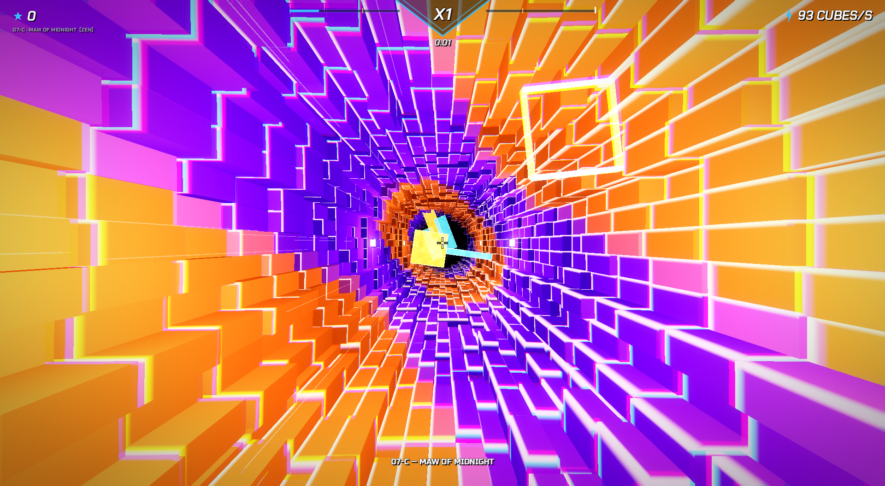

# Sensory Overload — Godot 4 Clean-Room Reconstruction (`v4.0.0`)

[-FF9F1C?style=for-the-badge&logo=windows&logoColor=0A0B0F&labelColor=0A0B0F)](https://github.com/lam3y35/sensory-overload-godot/releases/latest/download/SensoryOverload-v4.0.0-Windows-x64.zip)
[-FF1E3C?style=for-the-badge&logo=linux&logoColor=white&labelColor=0A0B0F)](https://github.com/lam3y35/sensory-overload-godot/releases/latest/download/SensoryOverload-v4.0.0-Linux-x64.zip)
[-38BDF8?style=for-the-badge&labelColor=0A0B0F)](https://github.com/lam3y35/sensory-overload-godot/releases/latest/download/SensoryOverload_60s_Trailer.mp4)

An independent, clean-room **Godot 4 + GDScript** reconstruction of *Sensory Overload*'s high-velocity 3D voxel-tunnel dropper gameplay, rebuilt from the ground up in **`v4.0.0`** with **carved axis-aligned 3D voxel shafts, analytical wall-sconce & headlamp lighting, translucent pixelated-voxel crystalline obstacles with physical-meter glowing rims, a stark brutalist commercial HUD, and a studio-mastered 44.1 kHz stereo Hard-Techno / Industrial OST**.

---

## Play in One Click (No Godot Install Required)

1. Click **[⬇ ONE-CLICK DOWNLOAD (`SensoryOverload-v4.0.0-Windows-x64.zip`)](https://github.com/lam3y35/sensory-overload-godot/releases/latest/download/SensoryOverload-v4.0.0-Windows-x64.zip)** *(or **[`SensoryOverload-v4.0.0-Linux-x64.zip`](https://github.com/lam3y35/sensory-overload-godot/releases/latest/download/SensoryOverload-v4.0.0-Linux-x64.zip)**, or watch the **[60s Gameplay Trailer (`SensoryOverload_60s_Trailer.mp4`)](https://github.com/lam3y35/sensory-overload-godot/releases/latest/download/SensoryOverload_60s_Trailer.mp4)**)*.
2. Extract and launch **`SensoryOverload.exe`**.
3. **Older GPU or Non-Vulkan System?** Run with OpenGL 3.3 Compatibility mode (`62+ FPS` verified):
   ```powershell
   SensoryOverload.exe --rendering-driver opengl3
   ```

---

## Screenshots (`v4.0.0` Live GPU Captures)

| Live 3D Voxel Tunnel Main Menu | Carved Voxel Shaft & Translucent Waffle |
| :---: | :---: |
|  |  |

| Brutalist HUD, Top Chevron & Near-Miss Feed | 24-Bit Shader Mutators & Speed Streaks |
| :---: | :---: |
|  |  |

| All Hallows' Level 7 (`96 CUBES/S`) | Built-In 3D Voxel Level Editor |
| :---: | :---: |
|  |  |

---

## What's New in `v4.0.0` (Ground-Up Visual, Audio & Brutalist UI Overhaul)

- **Carved Axis-Aligned 3D Voxel Tunnel & Analytical Sconce Lighting:** Rebuilt the tunnel shaft into a `46`-ring × `48`-cell (`2,208`-instance) zero-overlap carved voxel grid with terraced radial depth relief, glowing white emissive wall-sconce blocks (`5` pairs every `28.8 m`), and fast vertex-evaluated analytical dual-sconce + player-headlamp 3D lighting (`voxel_tunnel.gdshader`).
- **Translucent Pixelated-Voxel Obstacles (`0.78` Alpha) with Physical-Meter Rims:** All 10 obstacle archetypes (`waffle`, `cross_bars`, `iris_ring`, `sliding_blades`, `pendulum`, `tumbling_cube`, `guillotine`, `drifting_ghost`, `spiral_slats`, `pillar_grid`) now render with world-space `0.72 m` pixelated voxel face texture, uniform physical-meter glowing edges (`u_half_extents`), and translucent glass bodies so upcoming obstacles remain readable through foreground barriers.
- **Stark Brutalist Commercial UI & Unobstructed HUD:** Bundled SIL OFL display typography (`RussoOne-Regular`, `ChakraPetch-Bold`, `ChakraPetch-BoldItalic`, `ChakraPetch-SemiBold`), carbon `#0A0B0F` panels with sharp `2px` corners and amber `#FF9F1C` / crimson `#FF1E3C` left-edge accents, bare top-left vector star + score, top-right vector lightning bolt + `CUBES/S` speed readout, custom top-center `V`-chevron `X1`..`X8` multiplier + split horizontal progress bar, and a middle-right stacking Near-Miss feed.
- **Live Infinite 3D Main Menu Backdrop:** Left-aligned chromatic-shadow `SENSORY OVERLOAD` title and brutalist navigation column floating directly over a live descending 3D voxel tunnel with drifting translucent obstacles.
- **Studio-Mastered 44.1 kHz Stereo Hard-Techno OST & Foley SFX:** Replaced procedural mono sine loops with **7 studio-mastered 44.1 kHz stereo `.ogg` tracks** (`128..152 BPM`, arranged with Berlin rumble kicks, PolyBLEP TB-303 resonant `LadderFilter` acid basslines, 909 industrial percussion, supersaw rave stabs, and `-0.8 dB` mastering limiter via Spotify `pedalboard`) plus **15 stereo 44.1 kHz `.wav` foley SFX cues**.
- **21 Art-Directed Campaign Stages Across 7 Levels:** Curated high-contrast tunnel and obstacle palettes (`54..96 CUBES/S`), 24-bit shader mutator combinations, Practice Mode checkpoints (`C`/`X`), Zen Mode, Ranked Endless with 60 Hz deterministic replays (`WATCH`), All Hallows' mode, and a built-in 3D Level Editor.

---

## Controls

| Input | Action |
| :--- | :--- |
| **Mouse** (or **WASD** / **Arrow Keys**) | Steer laterally inside the 3D voxel shaft (roll-compensated) |
| **Hold Left Click** / **Shift** / **Space** | **Overdrive Boost** (`1.48x` speed + `2x` distance score + Flow gain) |
| **Right Click** / **E** | **Phase Dash & Parry** (invulnerability blink; dash through barriers to Parry `+800x` & reset cooldown) |
| **C** / **X** | Place / Clear Checkpoint *(Practice Mode)* |
| **R** / **Space** *(on Death)* | Instant `<0.1s` Retry |
| **Enter** / **Space** *(on Clear)* | Launch Next Campaign Stage |
| **Esc** / **P** | Pause / Resume |

---

## Running from Source & Automated Verification

Requires **Godot 4.7.2+** (`godot` / `godot_console`) and **Python 3.10+**:

```bash
# 1. Static integrity & schema validation
python tools/validate_godot_project.py

# 2. Run headless unit & integration suites (6 suites, 123 assertions)
godot_console --headless --path . res://tests/test_runner.tscn

# 3. Launch the game in Godot
godot --path .
```

See [`docs/QA_REPORT.md`](docs/QA_REPORT.md) for QA verification metrics and [`docs/GAME_DESIGN_DOCUMENT.md`](docs/GAME_DESIGN_DOCUMENT.md) for architecture details.

---

## Clean-Room & License Notice

This project is an independent clean-room reconstruction written from scratch in GDScript and Godot GLSL shaders, informed solely by public store materials and structural reverse-engineering documentation. It contains **zero** proprietary source code, binaries, textures, audio, or copyrighted assets. Fonts (`Russo One`, `Chakra Petch`) are licensed under the SIL Open Font License 1.1; code and original assets are licensed under the [MIT License](LICENSE).
