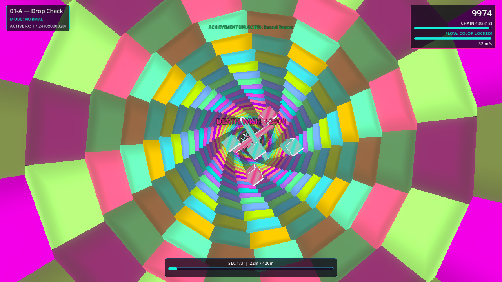
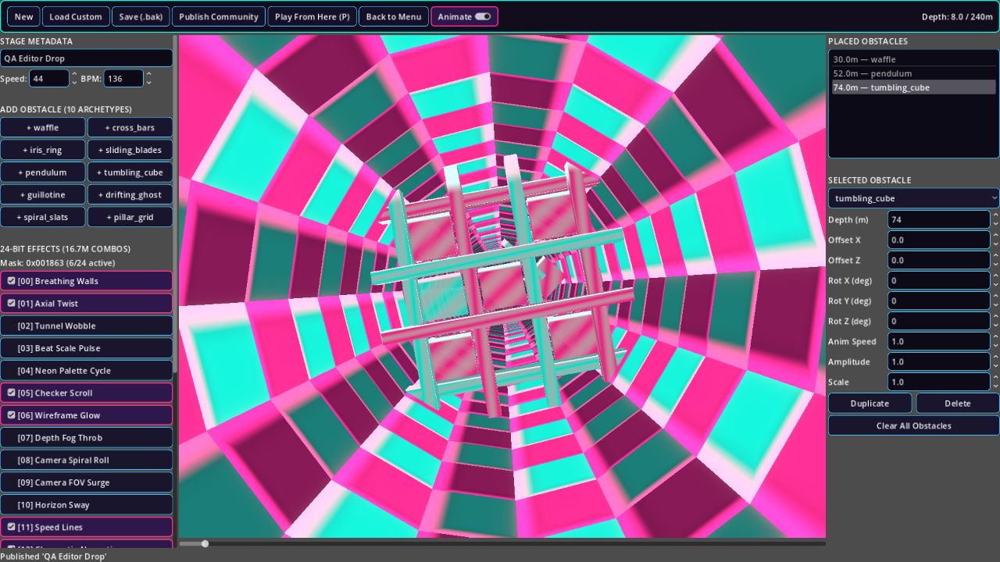
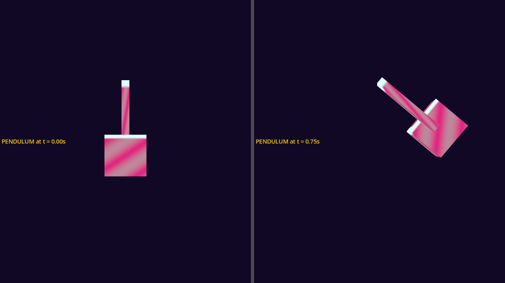

# Sensory Overload — Godot 4 Clean-Room Reconstruction

[-14F1D9?style=for-the-badge&logo=windows&logoColor=0A0618&labelColor=0A0618)](https://github.com/lam3y35/sensory-overload-godot/releases/latest/download/SensoryOverload-Windows-x64.zip)
[-FF2E93?style=for-the-badge)](https://github.com/lam3y35/sensory-overload-godot/releases/latest/download/SensoryOverload-Windows-x64.exe)
[-FACC15?style=for-the-badge&logo=linux&logoColor=white&labelColor=1F1638)](https://github.com/lam3y35/sensory-overload-godot/releases/latest/download/SensoryOverload-Linux-x64.tar.gz)

An independent, clean-room **Godot 4 + GDScript** reconstruction of high-speed 3D voxel-tunnel arcade gameplay, built from public technical observations with **100% original source code, custom GLSL shaders, procedural synth audio, and handcrafted campaign data**.

---

## Play in One Click (No Godot Install Required)

1. Click **[⬇ ONE-CLICK DOWNLOAD (Windows x64 ZIP)](https://github.com/lam3y35/sensory-overload-godot/releases/latest/download/SensoryOverload-Windows-x64.zip)** *(or grab the direct standalone [`SensoryOverload-Windows-x64.exe`](https://github.com/lam3y35/sensory-overload-godot/releases/latest/download/SensoryOverload-Windows-x64.exe) or [`SensoryOverload-Linux-x64.tar.gz`](https://github.com/lam3y35/sensory-overload-godot/releases/latest/download/SensoryOverload-Linux-x64.tar.gz))*.
2. Extract (if using the ZIP/tar.gz) and run **`SensoryOverload.exe`**.
3. **No Vulkan GPU?** Run with OpenGL 3.3 Compatibility mode:
   ```powershell
   SensoryOverload.exe --rendering-driver opengl3
   ```

---

## Screenshots (Live GPU QA Captures)

| Main Menu | Near-Miss Graze & Flow State |
| :---: | :---: |
|  |  |

| 24-Bit Sensory Overload FX | Built-in 3D Level Editor |
| :---: | :---: |
|  |  |

| Exact Un-Sheared OBB & Pendulum Motion |
| :---: |
|  |

---

## Key Features

- **21 Progressive Campaign Stages + Community Showcase (`7` Speed & Effect Tiers):**
  Handcrafted sequences generated cleanly from `data/levels/campaign_levels.json`, scaling speed, obstacle density, and visual intensity across 3 sections per stage.
- **10 Dynamic 3D Obstacle Archetypes with Swept Analytical OBB Collision:**
  `waffle`, `cross_bars`, `iris_ring`, `sliding_blades`, `pendulum`, `tumbling_cube`, `guillotine`, `drifting_ghost`, `spiral_slats`, and `pillar_grid` — evaluated via continuous swept OBB intersection (`SweptCollision`) so high-speed descents (`80–200+ m/s`) never tunnel through thin blades.
- **Near-Miss Proximity Grazing & Flow Multiplier (`1.0x – 8.0x`):**
  Skim close to obstacles for `NEAR MISS`, `DAREDEVIL`, and `DEATH WISH` bonuses, chaining combos into a color-locked **Flow State** (`>= 70%`).
- **5 Playable Modes:**
  - **Normal (Campaign):** Instant-death collision with a dramatic `0.35 s` impact freeze-frame & camera pullback.
  - **Practice Mode:** Drop & respawn at checkpoints anywhere (`Space`).
  - **Zen Mode:** Collision-free flow run for rhythm learning and practice.
  - **Ranked Endless:** Endless lap wrapping with escalating descent velocity and local leaderboard persistence.
  - **All Hallows':** High-intensity variant mode.
- **24-Bit Sensory Effect Compositor & Accessibility Safe Mode:**
  Up to `2^24` effect bitmask combinations (`radial wave`, `kaleidoscope`, `chromatic split`, `speed lines`, `strobe`, `invert`, `whiteout`, etc.), with **Photosensitivity Safe Mode** cleanly clamping high-risk flicker/flash bits.
- **60 Hz Replay Recording & Playback:**
  Ranked Endless runs automatically record 60 Hz trajectory replays bound directly to leaderboard entries (`WATCH`).
- **Built-In 3D Level Editor & `Play From Here` Testing:**
  Add, duplicate, inspect, move, color, and delete obstacles, toggle section effects, preview with an isolated 3D clock, save/load `.json` stages with `.bak` safety backups, and jump straight into live gameplay at the editor camera depth.
- **Zero-Crossing Procedural Techno Synth Audio:**
  In-engine synthesized 4-beat looping WAV waveforms synced cleanly to stage BPM, beat phase, and pause/death audio toggles.
- **20 Unlockable Achievements & Dual Renderer Parity:**
  Tested and visually verified on both **Vulkan 1.4 Forward+** and **OpenGL 3.3 Compatibility**.

---

## Controls

| Input | Action |
| :--- | :--- |
| **Mouse** (or **WASD** / **Arrow Keys**) | Steer laterally inside the 3D voxel tunnel |
| **Space** | Set / warp to Checkpoint *(Practice Mode)* |
| **R** | Quick Retry |
| **Esc** / **P** | Pause / Resume |

---

## Running from Source & Automated Verification

Requires **Godot 4.7.2+** (`godot` / `godot_console`) and **Python 3.10+**:

```bash
# 1. Static integrity & schema validation
python tools/validate_godot_project.py

# 2. Run headless unit & integration suites (6 suites, 96 assertions)
godot_console --headless --path . res://tests/test_runner.tscn

# 3. Launch the game in Godot
godot --path .
```

See [`docs/QA_REPORT.md`](docs/QA_REPORT.md) for the full GPU visual QA methodology and before/after verification metrics, and [`docs/GAME_DESIGN_DOCUMENT.md`](docs/GAME_DESIGN_DOCUMENT.md) for system architecture details.

---

## Clean-Room & License Notice

This project is an independent clean-room reconstruction written entirely from scratch in GDScript and Godot GLSL shaders, informed solely by public store materials and structural reverse-engineering documentation. It contains **zero** proprietary source code, binaries, textures, audio, or copyrighted assets. Licensed under the [MIT License](LICENSE).
