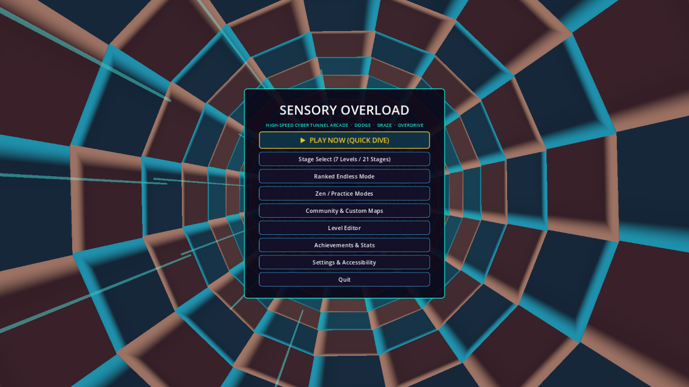
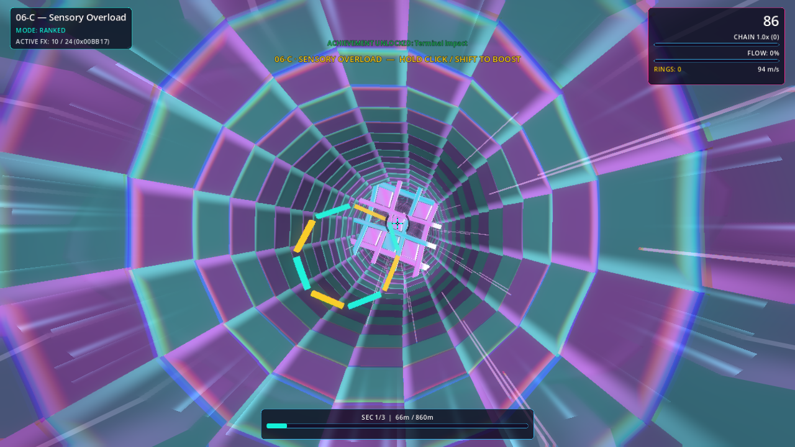

# Sensory Overload — Godot 4 Clean-Room Reconstruction (`v2.0.0`)

[-14F1D9?style=for-the-badge&logo=windows&logoColor=0A0618&labelColor=0A0618)](https://github.com/lam3y35/sensory-overload-godot/releases/latest/download/SensoryOverload-Windows-x64.zip)
[-FF2E93?style=for-the-badge)](https://github.com/lam3y35/sensory-overload-godot/releases/latest/download/SensoryOverload-Windows-x64.exe)
[-FACC15?style=for-the-badge&logo=linux&logoColor=white&labelColor=1F1638)](https://github.com/lam3y35/sensory-overload-godot/releases/latest/download/SensoryOverload-Linux-x64.tar.gz)

An independent, clean-room **Godot 4 + GDScript** reconstruction of high-speed 3D voxel-tunnel arcade gameplay, built with **100% original source code, custom GLSL shaders, procedural cyber-synthwave audio, Hyper-Boost, Energy Rings, and handcrafted campaign stages**.

---

## Play in One Click (No Godot Install Required)

1. Click **[⬇ ONE-CLICK DOWNLOAD (Windows x64 ZIP)](https://github.com/lam3y35/sensory-overload-godot/releases/latest/download/SensoryOverload-Windows-x64.zip)** *(or grab the direct standalone [`SensoryOverload-Windows-x64.exe`](https://github.com/lam3y35/sensory-overload-godot/releases/latest/download/SensoryOverload-Windows-x64.exe) or [`SensoryOverload-Linux-x64.tar.gz`](https://github.com/lam3y35/sensory-overload-godot/releases/latest/download/SensoryOverload-Linux-x64.tar.gz))*.
2. Extract (if using the ZIP/tar.gz) and run **`SensoryOverload.exe`**.
3. **No Vulkan GPU?** Run with OpenGL 3.3 Compatibility mode:
   ```powershell
   SensoryOverload.exe --rendering-driver opengl3
   ```

---

## Screenshots (`v2.0.0` Live GPU Captures)

| Main Menu (1-Click Quick Dive) | Tunnel Descent & Energy Rings |
| :---: | :---: |
|  |  |

| Overdrive Boost, Flow Lock & Reticle | Sensory Overload FX (Zero Tear) |
| :---: | :---: |
|  |  |

| Built-in 3D Level Editor |
| :---: |
|  |

---

## Key Features (`v2.0.0` Overhaul)

- **Crisp Dark-Cyber Aesthetics & Depth Cueing:** Dark metallic-bevel tunnel walls with BPM-synced energy rings let glowing hazard obstacles and Energy Rings pop effortlessly, with smooth spawn fade-in, non-coplanar zero Z-fighting geometry, and zero kaleidoscope screen tear.
- **Active Hyper-Boost & 3D Speed Streaks (`Hold Click / Shift / Space`):** Accelerate `1.48x` (up to `155 m/s`), double distance scoring, expand peripheral FOV, and ignite golden 3D MultiMesh speed-streak needles.
- **Collectible Energy Rings:** Deterministically threaded golden-cyan hoops award `+300 * Chain` points, boost Flow toward **Overdrive Color Lock**, trigger rising pitch-scaled synth chimes, spark bursts, and FOV punch.
- **Roll-Compensated Precision Steering & 120 Hz Sub-Stepping:** Screen-aligned Mouse/Keyboard/Controller steering locked to camera roll (`zero` double-integration mouse drift) plus variable-rate sub-stepping (`120 Hz` internal steps) for butter-smooth frame pacing.
- **Eye-Centered Telemetry Reticle:** Live Flow Lock crescent, Boost/Chain arc, and cockpit wall-margin indicator right around your crosshair.
- **10 Dynamic 3D Obstacle Archetypes with Swept Analytical OBB Collision:** `waffle`, `cross_bars`, `iris_ring`, `sliding_blades`, `pendulum`, `tumbling_cube`, `guillotine`, `drifting_ghost`, `spiral_slats`, and `pillar_grid` with near-miss proximity grazing (`NEAR MISS`, `DAREDEVIL`, `DEATH WISH`), `S+`–`C` rank grading, and `0.35 s` impact freeze-frame.
- **5 Playable Modes:** Normal Campaign (`21` stages / `7` tiers + `▶ PLAY NOW` Quick Dive), Practice (`C`/`X` Checkpoints), Zen, Ranked Endless (`WATCH` 60 Hz Replays + leaderboards), and All Hallows'.
- **Warm 8-Beat Cyber-Synthwave Procedural Audio & Menu Ambient:** LP-filtered rolling basslines, detuned supersaw pads, plucked arpeggios, snare/hat grooves, and pitch-escalating combo SFX.
- **24-Bit Sensory Effect Compositor & Accessibility Safe Mode:** Toggle photosensitivity safety clamping anytime in Settings.
- **Built-In 3D Level Editor (`Play From Here`):** Full visual authoring, duplicate/clear actions, `.bak` backups, and instant live playtesting.

---

## Controls

| Input | Action |
| :--- | :--- |
| **Mouse** (or **WASD** / **Arrow Keys**) | Steer laterally inside the 3D voxel tunnel (roll-compensated) |
| **Hold Left Click** / **Shift** / **Space** | **Hyper-Boost** (`1.48x` speed + `2x` distance score + Flow gain) |
| **C** / **X** | Place / Clear Checkpoint *(Practice Mode)* |
| **R** / **Space** *(on Death)* | Instant Retry |
| **Enter** / **Space** *(on Clear)* | Launch Next Campaign Stage |
| **Esc** / **P** | Pause / Resume |

---

## Running from Source & Automated Verification

Requires **Godot 4.7.2+** (`godot` / `godot_console`) and **Python 3.10+**:

```bash
# 1. Static integrity & schema validation
python tools/validate_godot_project.py

# 2. Run headless unit & integration suites (6 suites, 103 assertions)
godot_console --headless --path . res://tests/test_runner.tscn

# 3. Launch the game in Godot
godot --path .
```

See [`docs/QA_REPORT.md`](docs/QA_REPORT.md) for the complete QA findings, `v2.0.0` overhaul changes, and verification metrics, and [`docs/GAME_DESIGN_DOCUMENT.md`](docs/GAME_DESIGN_DOCUMENT.md) for system architecture details.

---

## Clean-Room & License Notice

This project is an independent clean-room reconstruction written entirely from scratch in GDScript and Godot GLSL shaders, informed solely by public store materials and structural reverse-engineering documentation. It contains **zero** proprietary source code, binaries, textures, audio, or copyrighted assets. Licensed under the [MIT License](LICENSE).
