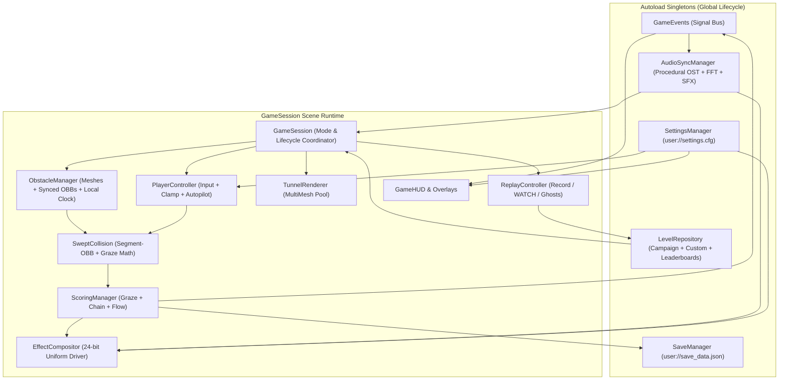

# Godot 4 Architecture Specification — *Sensory Overload* Reconstruction

> **Document Status:** Architecture & Module Contract (Milestone 0)  
> **Target Runtime:** Godot `4.3+` / `4.4` (64-bit, Pure GDScript, Vulkan Forward+ & OpenGL Compatibility)  
> **Project Root:** `c:\Users\Tweety\Documents\ANT\sensory-overload-godot\`  
> **Related Docs:** [GAME_DESIGN_DOCUMENT.md](GAME_DESIGN_DOCUMENT.md) · [IMPLEMENTATION_ROADMAP.md](IMPLEMENTATION_ROADMAP.md) · [Technical Findings](../../technical-findings.md)

---

## 1. Engine & Renderer Compatibility Contract

- **`[BASED ON VERIFIED FINDING]` `VF-01` & `VF-03`:** Targets 64-bit Godot 4 (`Windows` / `Linux`), supporting both **Forward+ / Mobile (Vulkan)** and **Compatibility (OpenGL ES 3 / ANGLE)** renderers identically.
- **`[INDEPENDENT IMPLEMENTATION]` Rendering Parity Rules:**
  - All three core shaders (`voxel_tunnel.gdshader`, `obstacle_painted.gdshader`, `sensory_postprocess.gdshader`) avoid Vulkan-only compute shaders, `storage_buffer`, or non-portable `sampler2D` tricks.
  - Post-processing executes on a full-screen `ColorRect` inside a dedicated `CanvasLayer` reading `hint_screen_texture`, ensuring 100% visibility across both Vulkan and Compatibility renderers (explicitly preventing the `VF-11` invisible-obstacle compatibility bug).
  - Global visual state uses explicit material uniforms pushed per frame by `EffectCompositor` and `SettingsManager` so behavior is deterministic across renderer backends.

---

## 2. Project Directory & Module Structure

```text
sensory-overload-godot/
├── project.godot
├── default_bus_layout.tres
├── docs/
│   ├── GAME_DESIGN_DOCUMENT.md
│   ├── ARCHITECTURE.md
│   └── IMPLEMENTATION_ROADMAP.md
├── data/
│   └── levels/
│       └── campaign_levels.json        # 7 Levels, 21 original stages (stage_v1 schema)
├── shaders/
│   ├── voxel_tunnel.gdshader           # Instanced voxel tunnel rings, breathing, twist, neon grid
│   ├── obstacle_painted.gdshader       # Layered painted obstacle shader, outline & opacity overrides
│   └── sensory_postprocess.gdshader    # Screen-space effects (aberration, kaleidoscope, strobe, etc.)
├── scripts/
│   ├── autoload/
│   │   ├── game_events.gd              # Typed global signal bus
│   │   ├── settings_manager.gd         # Graphics, controls, audio, accessibility & crosshair config
│   │   ├── save_manager.gd             # Campaign unlocks, UUID-isolated map stats, ghosts, achievements
│   │   ├── level_repository.gd         # Campaign + user:// custom maps, backups, load guard, leaderboards
│   │   └── audio_sync_manager.gd       # Procedural synth OST loops, FFT/BPM sync, death/retry audio FSM
│   ├── data/
│   │   ├── effect_catalog.gd           # 24-bit effect registry, metadata, safe-mode weights
│   │   ├── obstacle_data.gd            # Serializable obstacle parameters & OBB definitions
│   │   ├── stage_data.gd               # Stage/section/effect/obstacle container & JSON validation
│   │   ├── replay_data.gd              # 60 Hz replay header, samples & serialization
│   │   └── achievement_catalog.gd      # 20 achievement definitions & evaluators
│   ├── gameplay/
│   │   ├── swept_collision.gd          # Continuous swept segment/sphere-to-OBB + 3-tier graze math
│   │   ├── tunnel_renderer.gd          # Pooled MultiMeshInstance3D voxel tunnel chunks
│   │   ├── obstacle_manager.gd         # Spawning, recycling, isolated animation clock & mesh/OBB sync
│   │   ├── player_controller.gd        # Mouse/Keyboard/Gamepad steering, boundary clamp & Autopilot
│   │   ├── scoring_manager.gd          # Graze tiers, chain multiplier, Flow meter, Zen/Ranked/Practice
│   │   ├── effect_compositor.gd        # 24-bit mask -> spatial/camera/shader uniform driver
│   │   ├── replay_controller.gd        # Live 60 Hz recorder, WATCH playback & spatial ghost markers
│   │   └── game_session.gd             # Top-level orchestrator for Normal/Ranked/Zen/Practice/WATCH/Test
│   ├── editor/
│   │   ├── level_editor.gd             # Interactive 3D editor controller (CRUD, Play From Here, backups)
│   │   └── level_preview_viewport.gd   # SubViewport animated level browser preview with isolated clock
│   └── ui/
│       ├── main_menu.gd                # Main hub over live animated 3D tunnel background
│       ├── level_select.gd             # Campaign & Community browser + leaderboards + WATCH button
│       ├── game_hud.gd                 # Crosshair canvas, graze popups, flow bar, practice/replay bars
│       ├── crosshair_drawer.gd         # Procedural vector crosshair (Dot, Cross, Ring, Outlined Plus)
│       ├── death_overlay.gd            # Delayed impact summary, retry, watch top run
│       ├── pause_menu.gd               # Resume, retry, Random Song, quick accessibility, quit
│       ├── settings_menu.gd            # Controls (exact 1.00x step), Audio, Graphics, Accessibility
│       └── achievements_menu.gd        # Unlocked achievements & global progression stats
├── scenes/
│   ├── main_menu.tscn
│   ├── game_session.tscn
│   ├── level_editor.tscn
│   └── ui/                             # Modular HUD, Pause, Settings, LevelSelect scenes
├── tests/
│   ├── test_runner.gd                  # SceneTree headless test suite runner (`godot --headless`)
│   ├── test_data_persistence.gd        # Serialization, backup rotation, load guard, stats isolation
│   ├── test_swept_collision.gd         # Tunneling resistance, tumbling OBB sync, 3-tier graze shells
│   ├── test_gameplay_modes.gd          # Scoring, chains, Zen section progress, Practice, Ranked
│   ├── test_replay_audio_effects.gd    # Replay roundtrip, 24-bit masks, procedural synth zero-click
│   └── test_editor_workflow.gd         # Editor CRUD, Play From Here depth, isolated preview clock
└── tools/
    └── validate_godot_project.py       # Static syntax/scene/reference validator (works without Godot binary)
```

---

## 3. System Dependency Graph & Signal Architecture



### Dependency Discipline
- **No Circular Dependencies:** Data classes (`scripts/data/`) depend only on each other (`StageData -> ObstacleData`, `EffectCatalog`). Gameplay modules communicate upward via `GameEvents` signals or explicit direct method calls from `GameSession`.
- **Decoupled Backend Boundary (`LeaderboardService` Pattern inside `LevelRepository`):** Community maps, stage leaderboards, and replay blobs read/write through clean repository methods (`publish_custom_stage`, `submit_ranked_run`, `get_stage_leaderboard`, `get_replay`) backed locally by `user://` JSON files, allowing future HTTP REST integration without touching gameplay code.

---

## 4. Canonical Physics & Collision Contract (`SweptCollision`)

### 4.1 Why Standard Frame-Discrete Colliders Fail (`[BASED ON VERIFIED FINDING]` `VF-09`)
At `82 m/s` and `60 Hz`, the player moves **`1.37 m` per physics tick** (and `2.73 m` at `30 FPS`). Thin voxel blades (`0.35 m` thick) or rotating bars will tunnel completely between discrete frames if tested only at end-of-frame positions, and rotating visual meshes desync if their bounding volumes lag behind animations.

### 4.2 Analytical Swept Segment-to-OBB Algorithm (`[INDEPENDENT IMPLEMENTATION]`)
`SweptCollision` operates as a pure, deterministic static utility class (directly testable in headless unit tests without GPU rendering):

1. **Input:**
   - `p0: Vector3` (previous physics position), `p1: Vector3` (current physics position), `player_radius: float = 0.32`.
   - Obstacle's current `Transform3D` (evaluated identically to its visual mesh at `obstacle_time`) and list of local OBB descriptors `{center: Vector3, half_extents: Vector3}`.
2. **Impact Check (Slab Test in Obstacle Local Space):**
   - Transform `p0` and `p1` by `T.affine_inverse()`.
   - Expand `half_extents` by `player_radius` (`ext = half_extents + Vector3.ONE * player_radius`, Minkowski-inflated box).
   - Perform Kay–Kajiya slab clipping across `X`, `Y`, `Z` axes over `t in [0.0, 1.0]`.
   - Returns `{hit: bool, hit_t: float, impact_point: Vector3}` — zero tunneling even at `500 m/s`!
3. **Graze Clearance (`d_min`):**
   - If `hit == false`, evaluate minimum distance from segment `[local_p0, local_p1]` to the uninflated OBB `[-half_extents, +half_extents]`, then subtract `player_radius`.
   - Sample segment closest-point iteratively/analytically across `X/Y/Z` slab projection (`8` steps + local refinement, `< 0.001 m` error), taking `min` across all OBB parts of that obstacle.
   - Classify into `NONE`, `NEAR_MISS` (`<= 1.65 m`), `DAREDEVIL` (`<= 0.95 m`), or `DEATH_WISH` (`<= 0.42 m`).

---

## 5. Rendering & Shader Architecture

### 5.1 `TunnelRenderer` (`MultiMeshInstance3D` Ring Pool)
- Pre-allocates `N = 64` tunnel ring chunks (each ring composed of `16` radial voxel segments, spacing `2.5 m`, spanning `160 m` visible tunnel ahead of camera).
- Each frame, chunks above `player_y + 10.0` recycle instantaneously ahead to the deepest frontier below `player_y`, updating `MultiMesh` transforms and per-instance custom data (`Color(ring_index, section_color_t, beat_seed, 1.0)`).
- `voxel_tunnel.gdshader` computes vertex breathing, axial twist, and wobble smoothly on GPU using `player_y`, `beat_phase`, `bass_energy`, and `effect_mask_flags` uniforms.

### 5.2 `ObstacleManager` & Isolated Animation Clocks
- Maintains active obstacle instances inside an active depth window `[player_y - 170.0, player_y + 15.0]`.
- Every obstacle computes its transform via a pure function `ObstacleManager.compute_obstacle_parts(obs_data: ObstacleData, local_time: float, beat_phase: float) -> Array[Dictionary]`, guaranteeing **visual meshes and collision OBBs always read the exact same transform matrix**.
- **Clock Isolation (`[BASED ON VERIFIED FINDING]` `VF-12` / *All Hallows* fix):** Each `GameSession` and `LevelPreviewViewport` owns its own independent `simulation_time: float` passed explicitly into obstacle evaluation — eliminating any shared/global animation-clock carryover between the level browser preview and live gameplay.

### 5.3 Material & Accessibility Uniforms
- `obstacle_painted.gdshader` accepts:
  - `u_opacity_override` (`0.20`–`1.00`, from `SettingsManager`)
  - `u_outline_brightness` (`0.0`–`2.0`)
  - `u_outline_thickness` (`0.0`–`1.0`)
  - `u_layer_color_primary`, `u_layer_color_accent` (layered painted depth look inspired by *All Hallows*)
  - `u_hit_highlight` (`0.0`–`1.0`, flashes crimson on the exact obstacle that caused death during the `0.35 s` impact freeze).

---

## 6. Data Schemas & Persistence Contracts (`[INDEPENDENT IMPLEMENTATION]`)

### 6.1 Stage & Custom Level Schema (`stage_v1`)
```json
{
  "schema": "stage_v1",
  "id": "custom_8f2a9c10",
  "title": "Neon Gauntlet",
  "author": "Player",
  "source": "custom",
  "bpm": 138.0,
  "track_index": 3,
  "base_speed": 48.0,
  "speed_ramp": 0.6,
  "tunnel_radius": 10.0,
  "palette": ["#14F1D9", "#FF2E93", "#1A0B2E"],
  "sections": [
    {
      "id": "sec_1",
      "length": 220.0,
      "effect_mask": 1029,
      "transition_gap": 32.0
    }
  ],
  "obstacles": [
    {
      "id": "obs_01",
      "type": "waffle",
      "depth": 55.0,
      "offset_xz": [0.0, 0.0],
      "rotation_deg": [0.0, 15.0, 0.0],
      "scale": [1.0, 1.0, 1.0],
      "speed": 0.8,
      "amplitude": 0.0,
      "phase": 0.0,
      "color_primary": "#FF2E93",
      "color_accent": "#FFE600"
    }
  ]
}
```

### 6.2 Corruption Guard, Backups & Isolated Map Stats (`VF-12` Mitigations)
1. **Per-Map Stats & Ghost Isolation (`SaveManager`):** `user://save_data.json` stores `map_stats[stage_id]` strictly keyed by unique `stage.id` (never by display name or shared slot), containing `{attempts, clears, high_score, best_chain, ghost_markers}`.
2. **Editor Load Guard & Pre-Save Backups (`LevelRepository`):**
   - Before overwriting `user://custom_levels/<id>.json`, `LevelRepository` copies the existing file to `user://custom_levels/backups/<id>_<unix_ms>.json.bak` (retaining latest 5 backups per level).
   - If JSON parsing or schema validation fails when loading a custom level, `LevelRepository.load_stage()` returns an explicit error result `{ok: false, error: ...}` and **refuses to open or overwrite** the file with an empty obstacle list (`VF-12` `1.0.1` fix).

### 6.3 Replay Schema (`60 Hz` Fixed-Step)
```json
{
  "schema": "replay_v1",
  "replay_id": "rep_01c_1795370000",
  "stage_id": "01_c",
  "mode": "ranked",
  "player_name": "Pilot",
  "score": 142500,
  "max_chain": 6.5,
  "duration_sec": 41.2,
  "cleared": true,
  "tick_hz": 60,
  "frames": [
    [0.0, 0.0, 0.0, 0.0]
  ]
}
```
Each compact frame stores `[y_depth, x_pos, z_pos, camera_roll_rad]` at `60 Hz` (plus optional event markers `[tick, event_type, value]`), ensuring **exact visual playback parity** (`WATCH` mode) resilient across future speed tuning.

---

## 7. Automated Testing & Validation Strategy

1. **Static Project Validator (`tools/validate_godot_project.py`):** Runs on any machine with Python 3.12 (verifies `.tscn` ext_resource paths, `project.godot` autoload paths, shader syntax structure, JSON campaign schema integrity, and zero circular script dependencies).
2. **Godot Headless Test Suite (`tests/test_runner.gd`):** Runs via `godot --headless --path . --script res://tests/test_runner.gd` to execute real engine assertions across all subsystems:
   - `SweptCollision`: `200 m/s` zero-tunneling verification, tilted/tumbling OBB sync, exact clearance classification (`Near Miss` / `Daredevil` / `Death Wish`).
   - `LevelRepository` & `SaveManager`: per-map stats isolation, pre-save `.bak` creation, corrupted JSON non-overwrite guard.
   - `ScoringManager`: multiplier scaling, `MAX_CHAIN`, `Zen` section advance on obstacle impact, `Practice` checkpoint state.
   - `EffectCatalog` & `AudioSyncManager`: 24-bit mask decoding (`0xFFFFFF`), Safe Mode strobe clamping, procedural PCM zero-crossing loop continuity.
   - `ReplayController`: record -> JSON serialize -> deserialize -> `WATCH` frame interpolation roundtrip.
   - `LevelEditor`: obstacle CRUD, `"Play From Here"` spawn depth, independent preview clock isolation.
